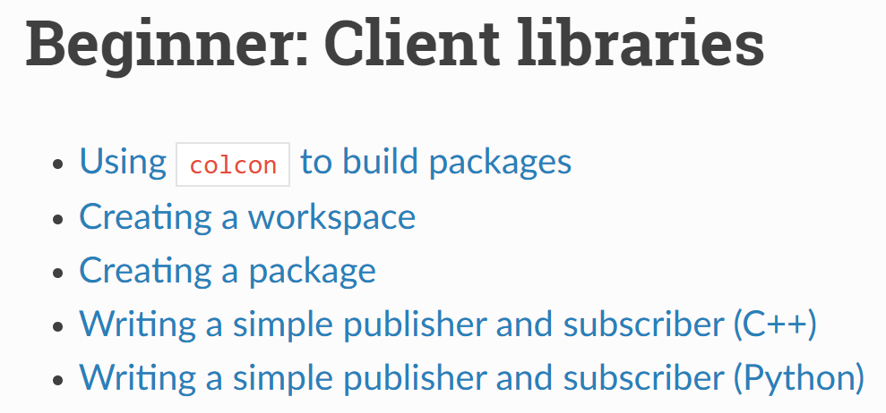
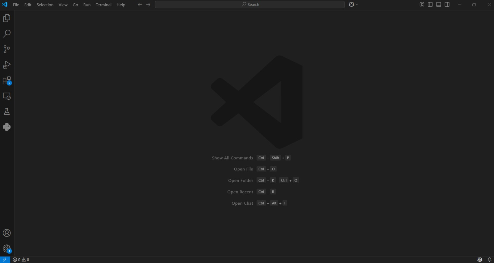
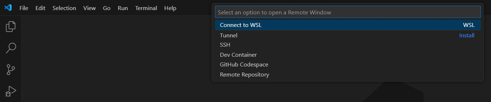
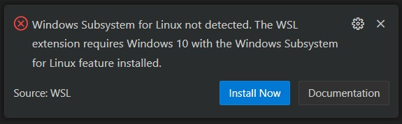
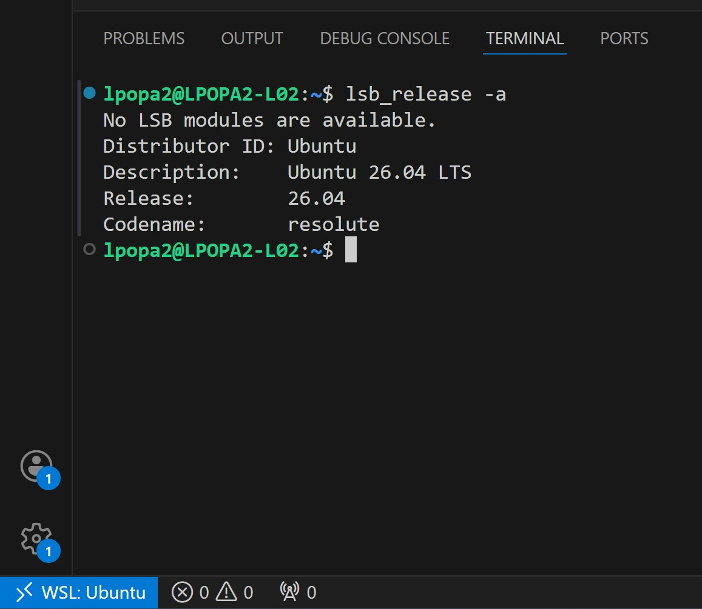

# Lab 1: Introduction to Tools and Frameworks

## Overview
This lab introduces you to the development environment and fundamental tools used throughout the course.

## Tasks
1. Familiarize yourself with the useful resources listed below.
2. Complete the [ROS2 Beginner: Client Libraries Tutorials](https://docs.ros.org/en/humble/Tutorials/Beginner-Client-Libraries.html).



## Preliminaries

> **Note for Lab PCs:** Lab computers run Ubuntu with Docker pre-installed. Just verify with `docker --version`, then skip to [Step 5: Setup ROS2 Docker Image](#step-5-setup-ros2-docker-image).

Before starting the labs, you need to set up a ROS2 development environment. Choose one of the options below.

---

## Option A: VSCode + WSL + Docker (Recommended for Windows)

This setup uses Visual Studio Code with the Windows Subsystem for Linux (WSL) and Docker Engine for a native Linux development experience on Windows.

### Step 1: Install Visual Studio Code

1. Download and install [Visual Studio Code](https://code.visualstudio.com/)
2. Launch VS Code



### Step 2: Install WSL Extension

1. Click the blue remote icon in the bottom-left corner of VS Code, or open the Command Palette with `Ctrl + Shift + P`
2. Select **Connect to WSL**



3. If WSL is not installed, you'll see a prompt to install it. Click **Install Now**.



4. Alternatively, install WSL manually from PowerShell (as Administrator):
   ```powershell
   wsl --install
   ```
   This installs Ubuntu by default. Restart your computer after installation.

### Step 3: Connect VS Code to WSL

1. After WSL is installed, click the remote connection icon (bottom-left corner of VS Code)
2. Select **Connect to WSL**
3. VS Code will reopen connected to your WSL Ubuntu instance
4. Open a terminal (`Ctrl + `` ` ``) to verify you're in Linux:
   ```bash
   lsb_release -a
   ```



### Step 4: Install Docker Engine in WSL

Inside your WSL terminal, install Docker Engine:

```bash
# Update package index
sudo apt update

# Install prerequisites
sudo apt install -y ca-certificates curl gnupg

# Add Docker's official GPG key
sudo install -m 0755 -d /etc/apt/keyrings
curl -fsSL https://download.docker.com/linux/ubuntu/gpg | sudo gpg --dearmor -o /etc/apt/keyrings/docker.gpg
sudo chmod a+r /etc/apt/keyrings/docker.gpg

# Add Docker repository
echo \
  "deb [arch=$(dpkg --print-architecture) signed-by=/etc/apt/keyrings/docker.gpg] https://download.docker.com/linux/ubuntu \
  $(. /etc/os-release && echo "$VERSION_CODENAME") stable" | \
  sudo tee /etc/apt/sources.list.d/docker.list > /dev/null

# Install Docker Engine
sudo apt update
sudo apt install -y docker-ce docker-ce-cli containerd.io docker-buildx-plugin docker-compose-plugin

# Add your user to docker group
sudo usermod -aG docker $USER
newgrp docker
```

Verify Docker installation:
```bash
docker --version
```

### Step 5: Setup ROS2 Docker Image

1. Pull the ROS2 Docker image:
   ```bash
   docker pull laurentiupopa/ros2-efac:ros2
   ```

2. Verify the image was downloaded:
   ```bash
   docker image ls
   ```
   You should see:
   ```
   REPOSITORY                TAG  
   laurentiupopa/ros2-efac   ros2
   ```

3. Enable display for Docker:
   ```bash
   xhost local:root
   ```

4. Run the container:
   ```bash
   docker run -it --privileged --network=host -e DISPLAY=$DISPLAY \
   -v /tmp/.X11-unix:/tmp/.X11-unix:ro laurentiupopa/ros2-efac:ros2
   ```
   > Note: Privileges enable hardware access, networking, and display sharing

5. You will enter the container's shell, indicated by prompt `root@<device_username>:/#`
6. Type `exit` or press `Ctrl+D` to leave the container shell

### Step 6: Container Management

After exiting the container:

1. List containers:
   ```bash
   docker ps -a
   ```

2. Rename container for easier reference:
   ```bash
   docker rename <container_name> humble
   ```

3. Start and access container:
   ```bash
   docker start humble
   docker exec -it humble bash
   ```

### Step 7: Verify ROS2 Setup

Inside the container:

```bash
# Source ROS2 environment
source /opt/ros/humble/setup.bash

# Check installation
ros2 pkg list | grep teleop_twist_keyboard

# Verify workspace exists
cd ~ && ls  # Should see ros_ws directory
```

### Step 8: Test ROS2 Communication

1. Open first terminal and access container:
   ```bash
   docker exec -it humble bash
   source /opt/ros/humble/setup.bash
   ros2 run demo_nodes_cpp talker
   ```

2. Open second terminal and access container:
   ```bash
   docker exec -it humble bash
   source /opt/ros/humble/setup.bash
   ros2 run demo_nodes_cpp listener
   ```

3. Verify messages are being exchanged between nodes
4. Use `Ctrl+C` in each terminal to stop the nodes

---

## Option B: Virtual Machine Setup (Alternative)

If you prefer not to use WSL, you can use a pre-configured virtual machine.

### Step 1: Download VirtualBox and ROS2 Image

1. Download and install [Oracle VirtualBox](https://www.virtualbox.org/wiki/Downloads)
2. Download the `.ova` image from [Google Drive](https://drive.google.com/uc?export=download&id=1VI4HPSwS0SAeqr2DJljcJwEwZ6_M3Szi)

### Step 2: Import the Virtual Machine

1. Open VirtualBox
2. Go to `File` > `Import Appliance`
3. Select the `.ova` file you downloaded
4. Configure the appliance settings:
   - Set **2 CPUs** (if your system supports it)
   - Allocate at least **4096MB RAM** (default 2048MB may work, but ROS2 nodes might lag or crash)
5. Click 'Finish' to complete the import
6. Click 'Start' to launch the VM

### Step 3: Login to the Virtual Machine

- **Username:** `arvr-ros2`
- **Password:** `arvr`

### Step 4: Verify the Ubuntu System

Open a terminal in the VM and run:

```bash
# Check Ubuntu version
lsb_release -a

# Source ROS2 environment
source /opt/ros/humble/setup.bash

# Verify ROS2 installation
which ros2

# Verify the teleop-twist-keyboard package is installed
ros2 pkg list | grep teleop_twist_keyboard
```

If the `teleop-twist-keyboard` package is not installed:
```bash
sudo apt update
sudo apt install ros-humble-teleop-twist-keyboard
```

---

## Useful Resources

- [ROS2 Humble Documentation](https://docs.ros.org/en/humble/)
- [ROS2 Tutorials](https://docs.ros.org/en/humble/Tutorials.html)
- [Docker Documentation](https://docs.docker.com/)
- [WSL Documentation](https://learn.microsoft.com/en-us/windows/wsl/)
